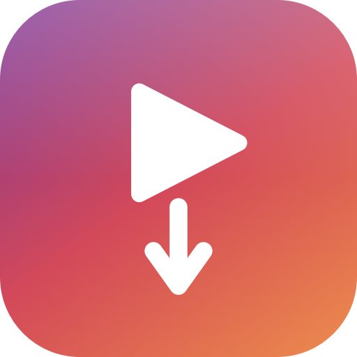
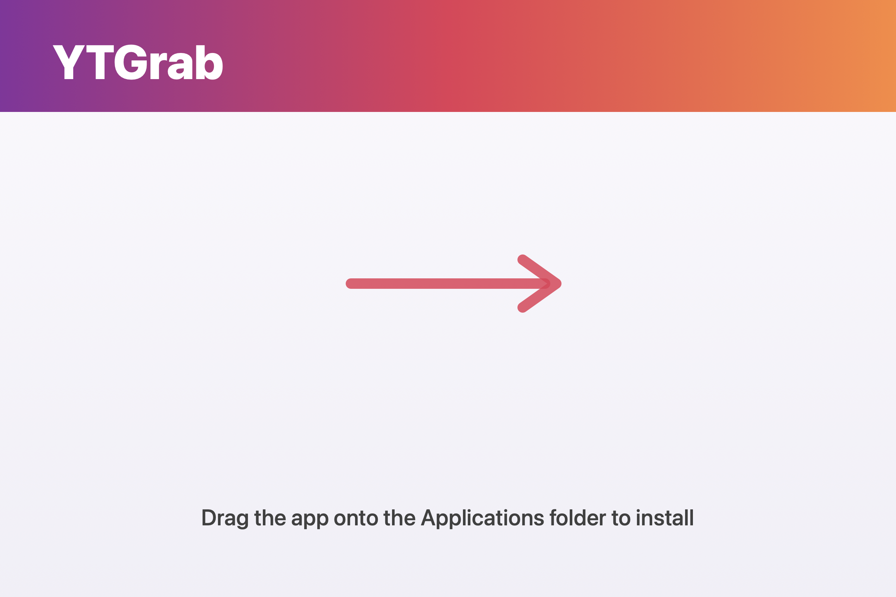

# YTGrab

A tiny, native macOS app for downloading videos and audio from the web — built with SwiftUI, powered by [yt-dlp](https://github.com/yt-dlp/yt-dlp), [FFmpeg](https://ffmpeg.org/) and [Deno](https://deno.com/). Works with any of the [1000+ sites yt-dlp supports](https://github.com/yt-dlp/yt-dlp/blob/master/supportedsites.md).

No Electron, no browser engine. The app binary is **~260 KB**; the rest of the bundle is the command-line tools it drives.





## Features

- 🎬 **Video → MP4** in H.264/AAC, so downloads play in QuickTime and on tablets/phones — sources only offered in other formats (WebM, MKV…) are converted automatically
- 🎵 **Audio → MP3** extraction
- 📋 **Whole-playlist** mode, with files numbered in playlist order
- 📂 Pick any output folder (defaults to `~/Downloads`)
- 📜 Live progress log with cancel support
- 🎨 Native SwiftUI UI with a gradient theme and a custom app icon

## Install

Download `YTGrab.dmg` from the [Releases](../../releases) page, open it, and drag **YTGrab** onto **Applications**.

Because the app is ad-hoc signed (not notarized), the first launch needs a one-time approval:

- **Right-click → Open**, then click **Open** in the dialog, _or_
- Run `xattr -dr com.apple.quarantine /Applications/YTGrab.app`

> **Architecture:** the bundled FFmpeg is an Apple Silicon (arm64) build, so the release targets Apple Silicon Macs.

## Build from source

Requires Xcode command-line tools (`swiftc`) on macOS.

```bash
cd build
./build.sh      # fetches yt-dlp + ffmpeg + deno, generates the icon, compiles, signs → ../YTGrab.app
./test.sh       # smoke-tests the built app with real downloads from localhost
./makedmg.sh    # builds the styled ../YTGrab.dmg with a custom background
```

`build.sh` is self-bootstrapping: on first run it downloads the bundled tools via
`fetch-deps.sh` and generates the icon. These large artifacts are git-ignored.

The tools are fetched at their latest versions, and video sites change often — if
downloads start failing, delete `build/Resources/` and rebuild to pick up a fresh yt-dlp.

### Command-line mode

The app binary can also run headless, which is what `test.sh` uses:

```bash
YTGrab.app/Contents/MacOS/YTGrab --cli [--mp3] [--playlist] [-o DIR] URL
```

### Project layout

| File | Purpose |
|------|---------|
| `build/main.swift` | The SwiftUI app (UI + yt-dlp process driver) |
| `build/Info.plist` | App bundle metadata |
| `build/icongen.swift` | Renders the app icon at all required sizes |
| `build/dmgbg.swift` | Renders the DMG background image |
| `build/fetch-deps.sh` | Downloads yt-dlp, static FFmpeg and Deno into `Resources/` |
| `build/build.sh` | Compiles and assembles `YTGrab.app` |
| `build/test.sh` | End-to-end smoke test of the built app |
| `build/makedmg.sh` | Produces the styled `YTGrab.dmg` |

## Acknowledgements

- [yt-dlp](https://github.com/yt-dlp/yt-dlp) — the download engine
- [FFmpeg](https://ffmpeg.org/) — muxing/transcoding (static build via [osxexperts.net](https://www.osxexperts.net/))
- [Deno](https://deno.com/) — JavaScript runtime yt-dlp needs for YouTube

## Disclaimer

Download only content you have the right to download (your own uploads,
public-domain, Creative Commons, or with the rights-holder's permission).
Respect each site's Terms of Service and applicable copyright law.

## License

[MIT](LICENSE)
